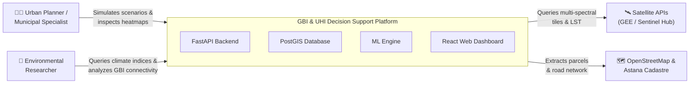
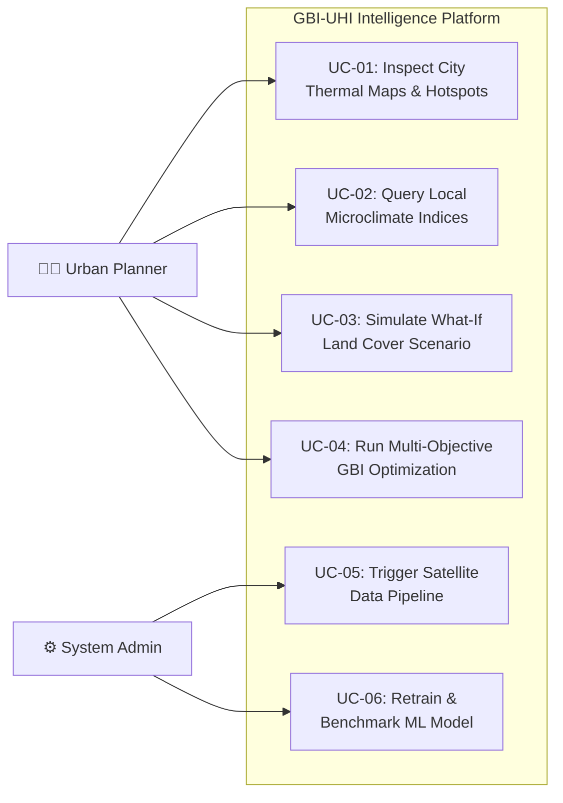
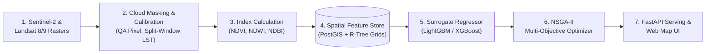

# System Architecture and Design Diagrams

This directory contains the editable source files and exports for all architectural and design diagrams required for the diploma pre-defense.

## Files

1. **System Context Diagram (C4 Level 1)**
   - Source: `system_context.drawio`
   - Description: Illustrates high-level boundaries, domain actors (Urban Planners, Environmental Researchers), external satellite APIs (GEE, Sentinel Hub, OpenStreetMap), and the core GBI-UHI decision support platform.

2. **UML Use Case Diagram**
   - Source: `use_case.drawio`
   - Description: Details planner and administrator interaction scenarios, including heatmap inspection, what-if simulation, and multi-objective GBI optimization.

3. **ML Component & Data Pipeline Diagram**
   - Source: `ml_pipeline.drawio`
   - Description: Maps the end-to-end data flow from raw Sentinel/Landsat rasters, through cloud masking, index calculation (NDVI/LST), feature extraction, surrogate ML prediction (LightGBM), to spatial PostGIS storage and FastAPI delivery.

## How to View and Edit
- Open [draw.io (diagrams.net)](https://app.diagrams.net/) in your web browser.
- Select **Open Existing Diagram** and pick any `.drawio` file from this folder.
- Alternatively, install the **Draw.io Integration** extension in VS Code.

---

## Diagram Previews (Mermaid)

The diagrams below are Mermaid replicas of the `.drawio` source files, rendered natively by GitHub for quick reading.

### 1. System Context Diagram (C4 Level 1)

### 2. UML Use Case Diagram

### 3. ML & Data Pipeline Diagram

