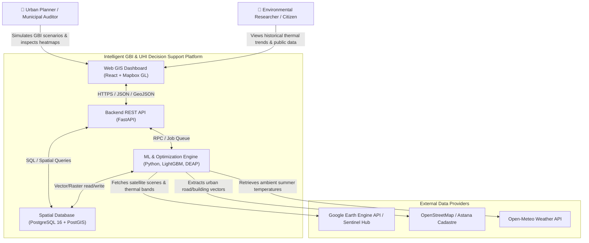
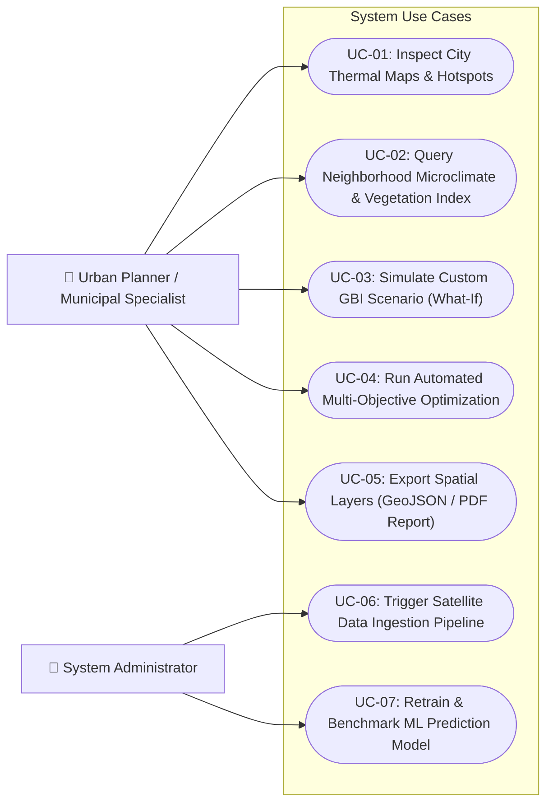
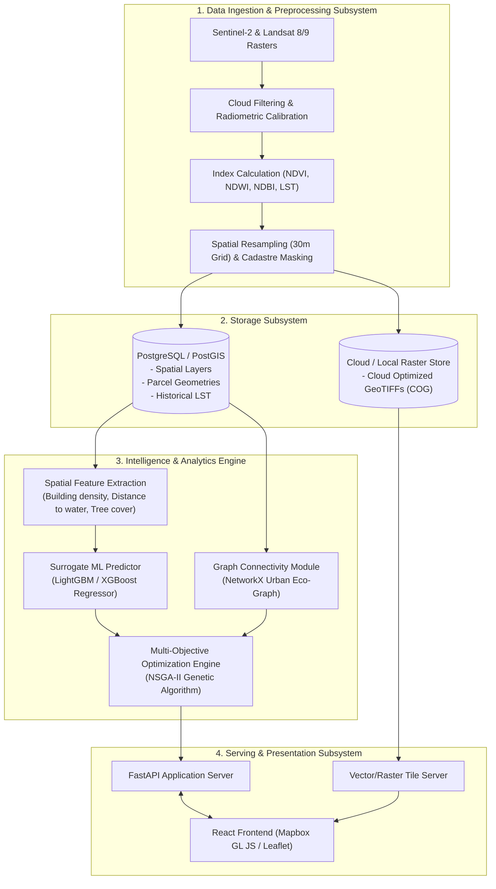

# Component 7: Architecture and Diagrams

**Responsible Persons**: 
- System Context & Use Case Diagrams: Zhetpis Baigulov
- ML Component & Data Pipeline Diagram: Ivan Kuznetsov

---

## 1. Architectural Overview
The system follows a modular, cloud-ready architecture designed to support heavy spatial data processing, machine learning inference, and responsive web visualization. The architecture aligns with the C4 model standards, encompassing:
1. **System Context (Level 1)**: Interactions between urban planners, external satellite APIs, and the core platform.
2. **Use Case Modeling**: User interactions, simulation workflows, and administrative actions.
3. **Component & Data Flow Diagram (Level 3 - Draft)**: Internal structure connecting satellite ingestion, GeoPandas/Rasterio preprocessing, LightGBM/XGBoost inference, PostGIS storage, and the FastAPI application layer.

Editable source files for all diagrams are preserved in the [`diagrams/`](../diagrams/) directory in `.drawio` format.

---

## 2. System Context Diagram (C4 Level 1)

---

## 3. Use Case Diagram

---

## 4. Component Diagram (Draft) and Data Flow

---

## 5. Architectural Alignment Matrix
- **Requirements to Architecture**:
  - `FR-01, FR-02` $\rightarrow$ Ingestion Subsystem (`src/ml/indices.py`).
  - `FR-03, FR-04` $\rightarrow$ Serving Subsystem (`src/backend/main.py`) & ML Engine.
  - `FR-05, FR-06` $\rightarrow$ Graph Network & Optimization Engine.
  - `FR-07` $\rightarrow$ React + Mapbox GL Dashboard.
