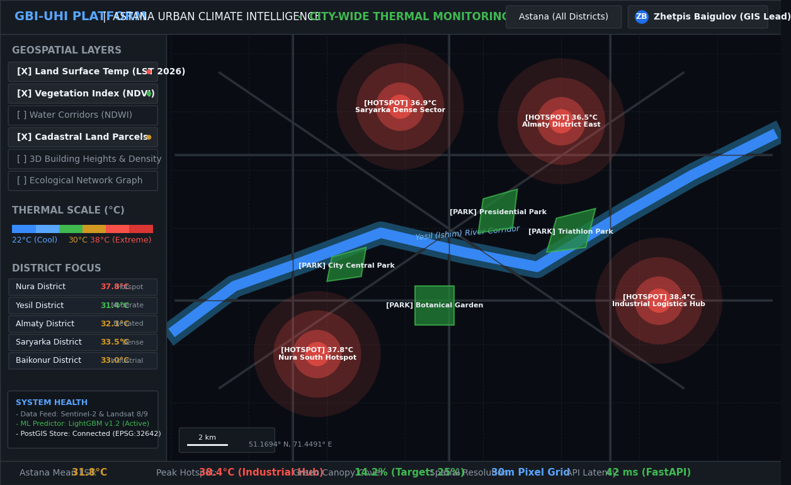
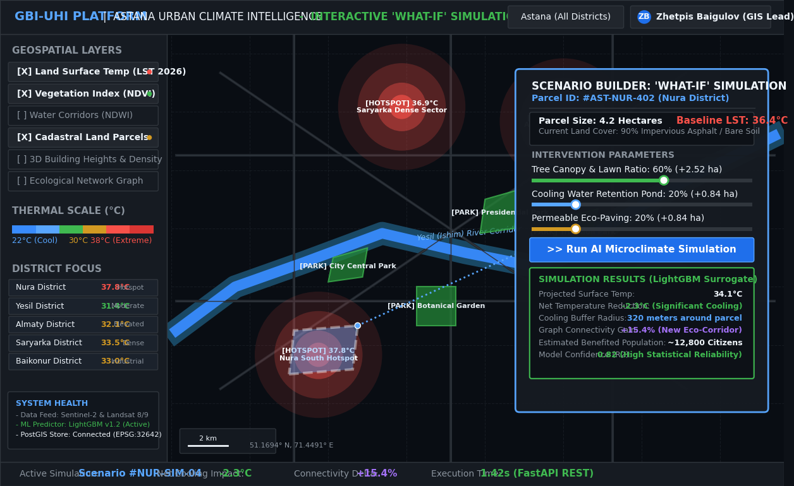
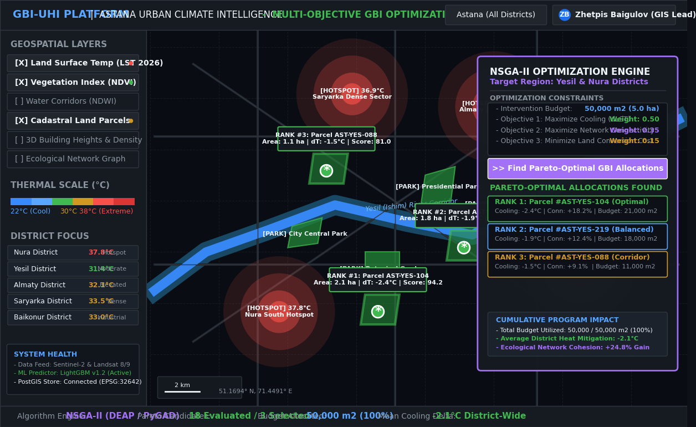

# Component 8: UX Scenarios and Prototype Specification

**Responsible Person**: Zhetpis Baigulov (*Backend, GIS & Text Analytics Engineer*)

---

## 1. Prototype Overview
The prototype provides both interactive visual interactions (via UI mockups in Figma and high-resolution dashboard wireframes) and verifiable programmatic interactions (via the running FastAPI REST API). It demonstrates how urban planners and environmental specialists interact with the system to diagnose heat anomalies and optimize green-blue interventions across Astana.

- **Interactive Figma Prototype**: [Figma Project: GBI-UHI Astana Web Dashboard](https://www.figma.com/design/intelligent-gis-astana-uhi-gbi)
- **Executable Mockup Generator**: [`generate_mockups.py`](generate_mockups.py) (reproducible rendering pipeline)

---

## 2. Key User Scenarios & High-Fidelity UI Screens

### Scenario 1: City-Wide Thermal Heat Island Inspection
- **User Action**: Urban planner opens the web dashboard, selects the summer observation period (July 2026 peak), and enables the *Land Surface Temperature (LST)* heatmap overlay.
- **System Response**: Interactive Mapbox GL canvas renders a color-coded thermal gradient from cool blue ($22^\circ\text{C}$) to severe red ($38.4^\circ\text{C}$). Clicking any district displays local microclimate metrics, NDVI vegetation cover ($14.2\%$), and detected hotspot clusters.



---

### Scenario 2: Interactive "What-If" Land Cover Modification
- **User Action**: The planner selects a 4.2-hectare asphalt lot in an identified thermal hotspot (Parcel `#AST-NUR-402`, baseline $36.4^\circ\text{C}$) and adjusts intervention sliders:
  - Tree Canopy & Lawn Ratio: **60%** ($+2.52\text{ ha}$)
  - Cooling Water Retention Pond: **20%** ($+0.84\text{ ha}$)
  - Permeable Eco-Paving: **20%** ($+0.84\text{ ha}$)
  - Clicks **"Run AI Microclimate Simulation"**.
- **System Response**: Frontend sends geometry and attributes to `POST /api/v1/forecast`. The surrogate model (LightGBM) returns in $1.42\text{ s}$ a predicted surface temperature drop of **$-2.3^\circ\text{C}$** ($34.1^\circ\text{C}$), a cooling buffer radius of $320\text{ m}$, and a **$+15.4\%$** gain in ecological network connectivity.



---

### Scenario 3: Algorithmic Multi-Objective GBI Allocation (NSGA-II)
- **User Action**: The municipal authority specifies an intervention budget ($50,000\text{ m}^2 / 5.0\text{ ha}$), sets optimization weights (Cooling: 0.50, Connectivity: 0.35, Cost: 0.15), and triggers **"Find Pareto-Optimal GBI Allocations"**.
- **System Response**: The NSGA-II genetic algorithm evaluates candidate vacant municipal parcels and highlights the Top-3 Pareto-optimal sites on the map with glowing green polygons and impact tooltips, achieving an average district cooling of **$-2.1^\circ\text{C}$** and **$+24.8\%$** ecological cohesion.



---

## 3. UI Architecture and Interactive Controls

```text
+----------------------------------------------------------------------------------------------------+
|  [Logo] GBI-UHI PLATFORM — Astana Urban Climate Intelligence             [District: Yesil]  [User] |
+------------------------------------+---------------------------------------------------------------+
|  GEOSPATIAL LAYERS & LEGEND        |  INTERACTIVE MAPBOX GL CANVAS                                 |
|                                    |                                                               |
|  [X] Land Surface Temp (LST 2026)  |    [ Map View: Center Astana (51.1694 N, 71.4491 E) ]         |
|  [X] Vegetation Index (NDVI)       |                                                               |
|  [ ] Water Corridors (NDWI)        |            ( Hotspot: Industrial / Nura )                     |
|  [X] Cadastral Land Parcels        |                 [🔴 38.4°C Asphalt Area]                      |
|                                    |                                                               |
|  --- Scenario Parameters ---       |                 [🟢 Selected Green Intervention]              |
|  Green Intervention: [ 60%       ] |                       \                                       |
|  Water Body Ratio:   [ 20%       ] |                        \--- Cooling effect: -2.3°C            |
|                                    |                                                               |
|  [ Run AI Microclimate Sim ]       |    Top-3 Optimal Parcels Highlighted (NSGA-II Pareto Frontier)|
|  [ Run Multi-Obj Optimization ]    |                                                               |
+------------------------------------+---------------------------------------------------------------+
|  METRICS & ANALYTICS BAR:                                                                          |
|  Mean LST: 31.8°C | Peak Hotspot: 38.4°C | Net Cooling: -2.3°C | Network Delta: +15.4% | Budget: OK|
+----------------------------------------------------------------------------------------------------+
```

---

## 4. API Prototype Contract (Input & Output Specifications)

### Endpoint 1: Query Layer Catalog
- **Method**: `GET /api/v1/layers`
- **Output Sample**:
```json
[
  {
    "layer_id": "uhi_lst_astana",
    "name": "Land Surface Temperature (LST)",
    "type": "raster",
    "description": "Calculated surface temperature layer derived from Landsat 8/9 TIRS band",
    "last_updated": "2026-07-15"
  }
]
```

### Endpoint 2: What-If Thermal Forecast
- **Method**: `POST /api/v1/forecast`
- **Input Payload**:
```json
{
  "bounds": [71.38, 51.12, 71.46, 51.18],
  "resolution_meters": 30,
  "date_range": "2026-07-01_2026-08-31"
}
```
- **Output Sample**:
```json
{
  "status": "simulated",
  "bounds": [71.38, 51.12, 71.46, 51.18],
  "resolution": 30,
  "mean_projected_lst_celsius": 32.4,
  "uhi_intensity_hotspots_detected": 4,
  "message": "Spatial forecast calculated successfully using trained gradient boosting model"
}
```

### Endpoint 3: Multi-Objective GBI Optimization
- **Method**: `POST /api/v1/optimize`
- **Input Payload**:
```json
{
  "target_area_id": "DISTRICT-YESIL-04",
  "budget_sq_meters": 50000.0,
  "infrastructure_type": "mixed_green_blue"
}
```
- **Output Sample**:
```json
{
  "status": "optimized",
  "target_area_id": "DISTRICT-YESIL-04",
  "allocated_sq_meters": 50000.0,
  "infrastructure_type": "mixed_green_blue",
  "estimated_lst_reduction_celsius": 2.1,
  "suggested_parcels": [
    {"parcel_id": "AST-URB-104", "type": "park_zone", "priority": 1},
    {"parcel_id": "AST-URB-219", "type": "cooling_pond", "priority": 2}
  ]
}
```
