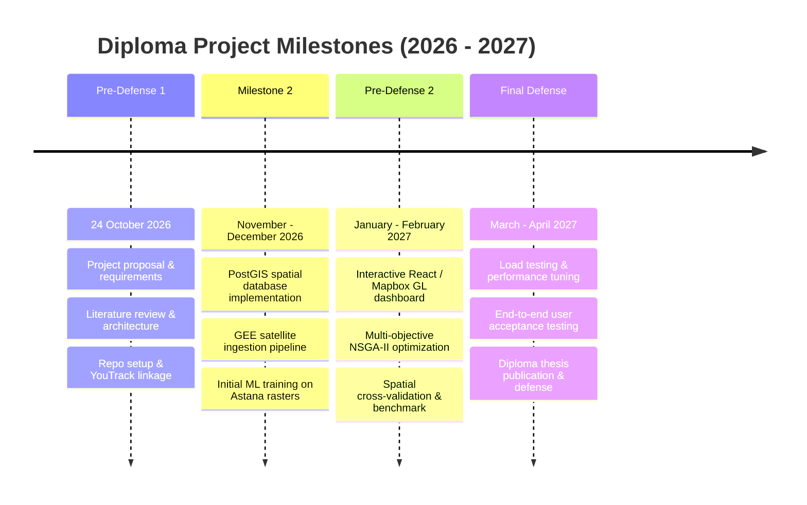

# Component 10: Project Management, Git Protocol, and Risk Registry

**Responsible Persons**: 
- Git & YouTrack Infrastructure: Ivan Kuznetsov
- Risk Matrix & Dependencies: Zhetpis Baigulov

---

## 1. Project Management Infrastructure

### YouTrack Project Setup
- **Project Name**: `GBI-UHI-Astana`
- **Project ID**: `DIP`
- **Instance URL**: `https://astanait.myjetbrains.com/youtrack/projects/DIP`
- **Board Configuration**: Agile Kanban board featuring columns:
  `Backlog` $\rightarrow$ `Ready for Dev` $\rightarrow$ `In Progress` $\rightarrow$ `Code Review (PR)` $\rightarrow$ `Done / Verified`
- **Traceability Policy**: Every meaningful unit of work has an associated ticket (`DIP-XX`). Commits, pull requests, and documentation references must explicitly include the ticket ID.

### YouTrack Task Backlog (Milestone: Pre-Defense 1)

| Task ID | Summary | Assignee | Branch Name | Status |
|---|---|---|---|---|
| **DIP-01** | Git Repository & Workspace Initialization | Ivan | `main` | **Done** |
| **DIP-02** | YouTrack Project Setup & Agile Board Configuration | Ivan | — | **Done** |
| **DIP-03** | Literature Review & Structured Analysis Matrix | Ivan | `DIP-03-literature-review` | **Done** |
| **DIP-04** | Remote Sensing & ML Technology Comparison | Ivan | `DIP-04-tech-comparison-ml` | **Done** |
| **DIP-05** | Verification and Evaluation Protocol Specification | Ivan | `DIP-05-verification-plan` | **Done** |
| **DIP-06** | Data Flow and ML Component Architecture Diagram | Ivan | `DIP-06-architecture-ml` | **Done** |
| **DIP-07** | Spatial Data Preprocessing & Indices Calculation Module | Ivan | `DIP-07-data-poc` | **Done** |
| **DIP-08** | Stakeholder Survey & Problem Relevance Evidence | Zhetpis | `DIP-08-relevance-survey` | **In Progress** |
| **DIP-09** | Existing GIS & Microclimate Systems Comparison | Zhetpis | `DIP-09-existing-systems` | **Done** |
| **DIP-10** | Backend & Spatial Database Technology Comparison | Zhetpis | `DIP-10-tech-backend-db` | **Done** |
| **DIP-11** | System Context & Use Case Diagrams | Zhetpis | `DIP-11-context-usecase-diagrams` | **Done** |
| **DIP-12** | UX Scenarios & Interactive Web Dashboard Wireframes | Zhetpis | `DIP-12-ux-wireframes` | **Done** |
| **DIP-13** | Project Risk Assessment & Mitigation Matrix | Zhetpis | `DIP-13-project-risks` | **Done** |
| **DIP-14** | Supervisor Feedback Protocol & Pre-Defense-1 Tagging | Ivan & Zhetpis | `DIP-14-supervisor-feedback` | **Ready** |

---

## 2. Git Workflow, Branching, and Review Protocol

1. **Main Branch Protection**: Direct pushes to `main` are restricted. All contributions must merge via GitHub Pull Requests.
2. **Branch Naming Standard**:
   `feature/<TASK_ID>-<short-description>` or `<TASK_ID>-<short-description>`
   - Example: `DIP-03-literature-review` (Ivan)
   - Example: `DIP-08-relevance-survey` (Zhetpis)
3. **Commit Message Format**:
   `<TASK_ID>: <Imperative concise description of changes>`
   - Example: `DIP-07: Implement vectorized NDVI and LST calculation functions`
4. **Peer Code Review Policy**:
   - Ivan must review and approve all Pull Requests authored by Zhetpis.
   - Zhetpis must review and approve all Pull Requests authored by Ivan.
   - Each PR must document: (1) what was changed, (2) which task it resolves, (3) how it was verified.
5. **Pre-Defense Tagging**:
   - `git tag -a pre-defense-1 -m "Official submission for Pre-Defense 1 - 24 October 2026"`
   - `git push origin pre-defense-1`

---

## 3. Project Milestones Timeline

---

## 4. Risk Matrix and Mitigation Strategies

| Risk ID | Category | Risk Description | Probability | Impact | Mitigation Strategy |
|---|---|---|---|---|---|
| **RSK-01** | **Data** | Excessive cloud cover over Astana during summer satellite passes, resulting in corrupted optical bands. | High | High | Implement multi-temporal cloud composite filtering (median composite over 90-day summer window in GEE) using QA pixel flags. |
| **RSK-02** | **Technical** | Google Earth Engine or Sentinel Hub free academic API quotas exceeded during large raster extractions. | Medium | Medium | Cache extracted GeoTIFF and NumPy arrays locally; use local raster processing (Rasterio/GDAL) for repeated model training iterations. |
| **RSK-03** | **Machine Learning** | Spatial autocorrelation causes model to overfit to specific urban geometry without generalizing across districts. | Medium | High | Enforce Spatial K-Fold block cross-validation (5 km blocks) instead of random pixel sampling. |
| **RSK-04** | **Performance** | Complex polygon spatial queries (intersections, buffering) slow down real-time web simulation. | Low | Medium | Build pre-computed spatial R-Tree (GiST) indices in PostGIS; convert heavy vector layers to lightweight Vector Tiles (MVT). |
| **RSK-05** | **Organizational** | Academic review delays or supervisor revisions right before pre-defense checkpoints. | Medium | High | Maintain weekly sprint check-ins every Wednesday; document feedback immediately in `docs/11_supervisor_feedback.md`. |
